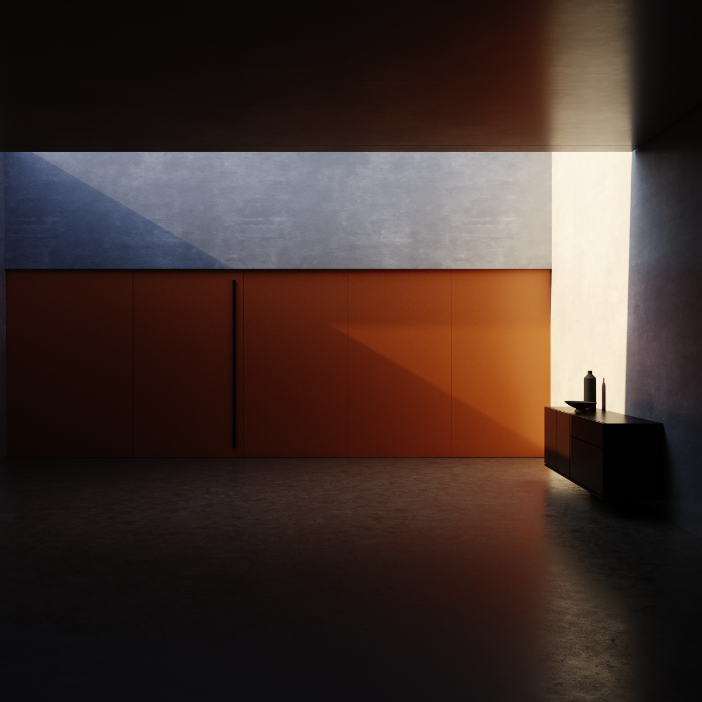
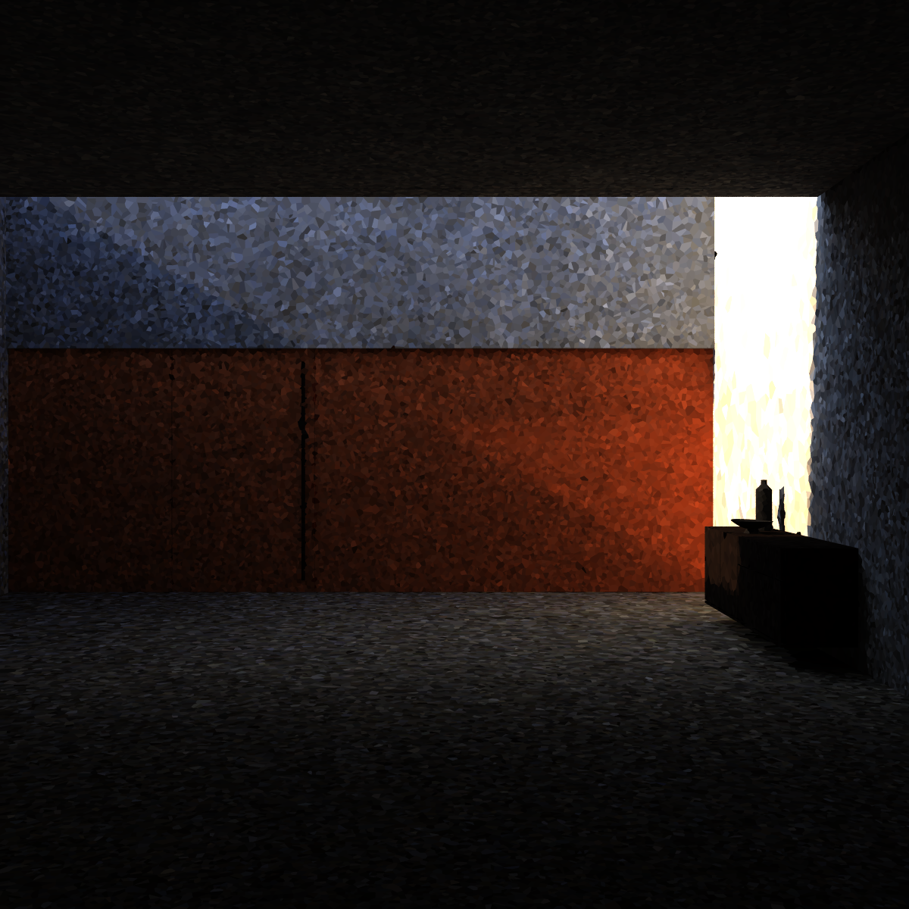
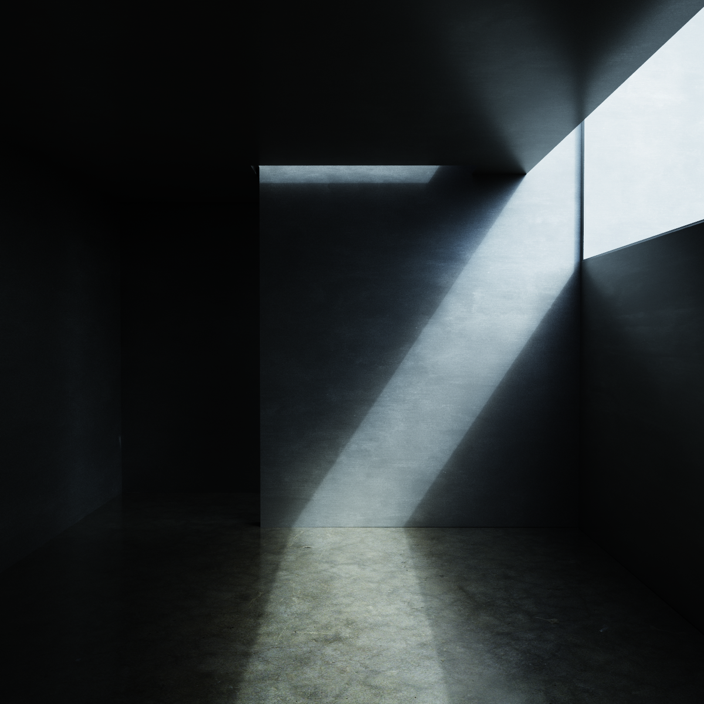
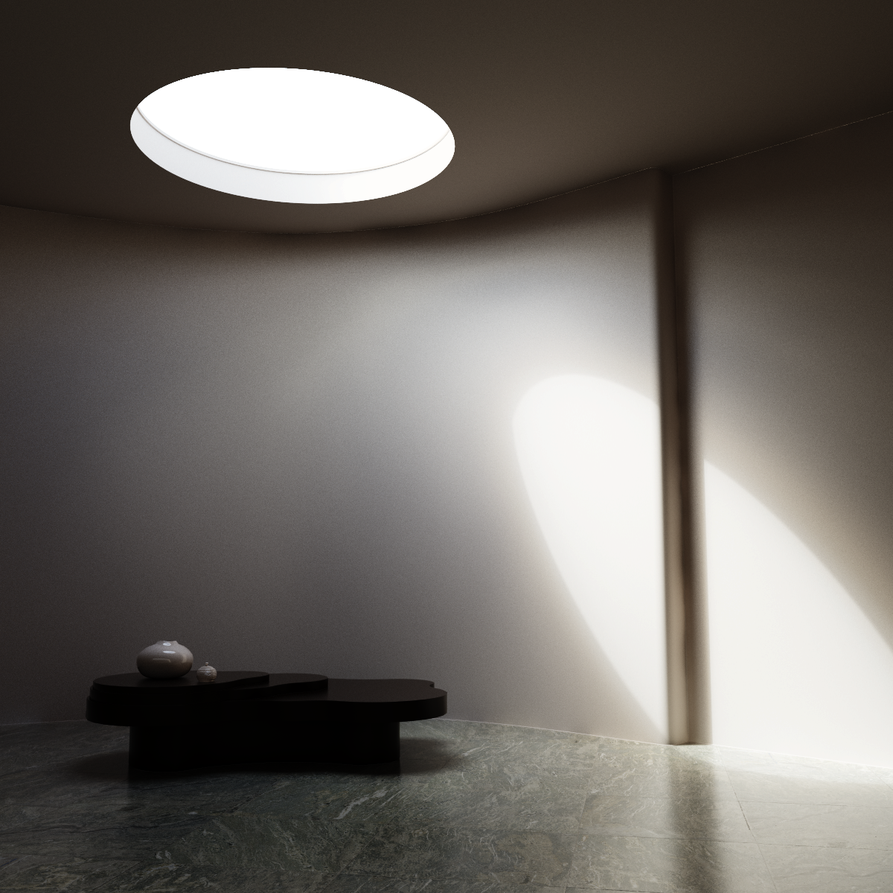

## Path tracer with radiance cached global illumination written in Rust

A long running on/off project where I play around with some rendering concepts.
The main focus of this renderer is the biased global illumination based on VRays irradiance map. At the moment the renderer does not store irradiance (incoming) but radiance (outgoing energy),
meaning view dependant effects like reflections and refractions are not factored into the GI yet.

The radiance map is a KD tree based point cloud created by first firing eye rays to find relevant primary ray intersections. We repeat this process and place samples where we find a lack of coverage based on position, surface orientation and
and lighting. From there we find secondary positions that may contribute light to our visible geometry.

After that we sample direct light together with one bounce for every created sample positions and store the result in the map. Then we repeat the process a bunch of times, but now we sample the cached
irradiance map from the last iteration to emulate the bouncing of light.

Architecture built at [Sooii](https://sooii.de/) for Qlocktwo

